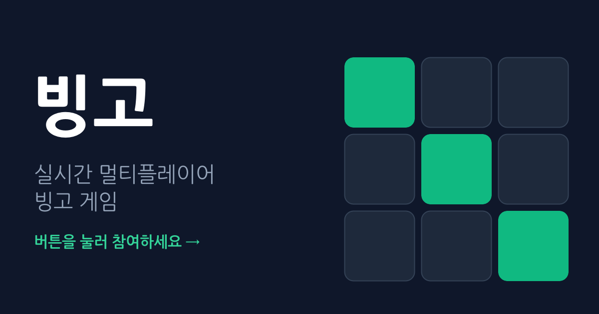
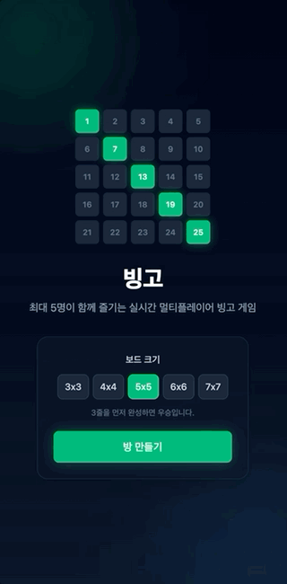
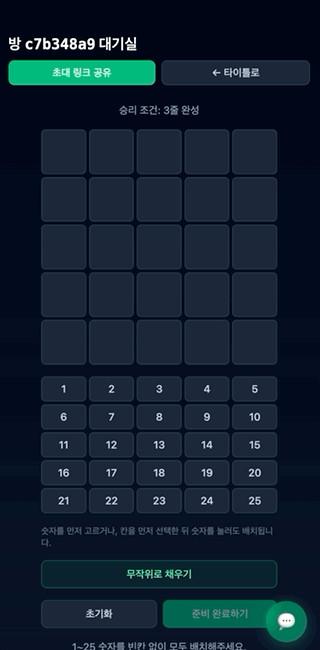
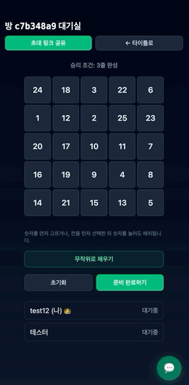
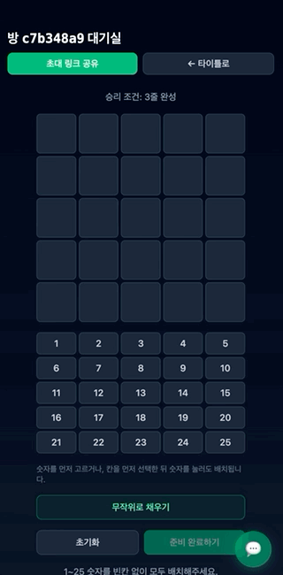
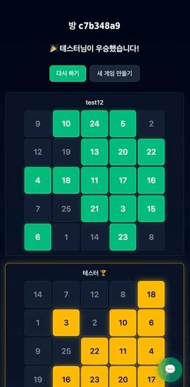

# 🎱 빙고 (Bingo)

> **서버 없이, 카카오톡 링크 하나로 5명까지 함께 즐기는 실시간 멀티플레이어 빙고 게임**
> 방을 만들어 링크를 공유하면, 친구들이 닉네임만 입력하고 바로 들어와 같은 방에서 턴제로 숫자를 부르며 게임합니다.

[](https://bingo-lime-nine.vercel.app/)
[](https://yonghun16.github.io/bingo/)
[](https://react.dev)
[](https://www.typescriptlang.org/)
[](https://vitejs.dev)
[](https://supabase.com)
[](https://bingo-lime-nine.vercel.app/)

<p align="center">
  <a href="https://bingo-lime-nine.vercel.app/">
    
  </a>
</p>

---

## 📌 프로젝트 개요 (Overview)

카카오톡으로 링크를 공유해 최대 5명이 브라우저만으로 함께 즐기는 실시간
빙고 게임입니다. 로그인/회원가입 없이 닉네임만 입력하면 바로 입장할 수
있고, 별도 게임 서버 없이 **Supabase Realtime(Broadcast + Presence)
하나로** 참가자 동기화부터 턴 진행, 승부 판정까지 전부 처리합니다.

**"게임 서버 없이 여러 클라이언트가 어떻게 하나의 게임을 함께 진행하는가"**를
처음부터 끝까지 풀어본 프로젝트입니다 — 상태의 원본은 항상 각 클라이언트
로컬에 있고, Supabase는 "방금 숫자가 호출됐다" 같은 이벤트를 방 전체에
중계만 하는 역할만 합니다. 턴 타이머 관리·시간초과 자동호출·동시우승
판정처럼 "누군가 대표로 계산해야 하는" 로직은 **Presence 입장 시각이 가장
이른 사람(호스트)**의 클라이언트가 맡고, 호스트가 나가면 다음 사람이
자동으로 이어받습니다.

- **타겟 사용자**: 카카오톡으로 초대받아 들어오는 친구/지인 5인 이하 그룹
- **핵심 목표**: 백엔드 서버 없이, 가입 없이, 링크 하나로 "지금 바로"
  시작할 수 있는 캐주얼 멀티플레이어 게임
- **라이브 데모**: 🔗 [https://bingo-lime-nine.vercel.app/](https://bingo-lime-nine.vercel.app/)
- **개발 문서**: 🔗 [온라인 기획/개발 문서 바로가기](https://yonghun16.github.io/bingo/)
  (기획, 개발 프로세스, LeanSpec 기능 스펙, "코드를 처음 보는 사람" 눈높이로
  쓴 학습 문서까지 포함)

이 프로젝트는 DB 테이블을 전혀 쓰지 않습니다 — 게임 기록을 영구
저장하지 않고, 새로고침/전원 퇴장 시 그 방의 상태는 완전히 초기화됩니다.
회원 시스템·결제·관전 기능은 의도적으로 범위 밖으로 뒀습니다.

---

## ✨ 주요 기능 (Key Features)

### 🧠 기술적으로 까다로웠던 부분

- 🖥️ **서버 없는 호스트 선출/승계**: "방에 가장 먼저 들어온 사람"을
  모든 클라이언트가 Presence 목록만 보고 각자 동일하게 계산 — 별도
  합의 절차나 "호스트 인수인계" 이벤트 없이, 호스트가 나가면 다음
  순번이 자동으로 역할(턴 타이머, 자동 호출, 동시우승 판정)을 이어받음
- 🔁 **`turnSeq` 기반 경합 해결**: 턴 유저의 수동 호출과 호스트의 시간초과
  자동 호출이 거의 동시에 나갈 수 있는 구조라, 매 턴 증가하는 일련번호를
  붙여 "가장 먼저 도착한 이벤트만 인정"하는 규칙으로 중복 처리를 막음
- 🔐 **보드 비공개 설계**: 내가 어디에 뭘 놨는지는 게임이 끝나기 전까지
  아무에게도 broadcast하지 않음 — 그래서 게임 종료 시 우승자 id만 먼저
  확정하고, 각자가 그제서야 자기 보드를 공개하는 2단계 구조로 설계
- 📶 **재접속 시 "원래 참가자 vs 낯선 사람" 구분**: 둘 다 Presence에서
  일시적으로 사라졌다 돌아오는 건 똑같아서, 게임 시작 시점에 고정해둔
  `turnOrder`에 내 닉네임이 있는지로 구분 — 원래 있던 사람은 상태를
  이어받고, 링크만 들고 끼어들려는 사람은 막음
- 🃏 **보드 크기별 가변 승리 조건**: 3x3~7x7 다섯 가지 보드 크기를
  지원하고, 숫자 범위·호출 가능 범위·완성해야 할 줄 수가 전부 크기에
  따라 달라지는 걸 하나의 공식(`크기 - 2`줄)으로 일반화

### 🎯 기획 판단이 담긴 부분

- 📱 **카카오톡 공유 중심 설계**: 방 만들기 → 초대 링크 복사 →
  카톡 공유가 핵심 플로우라, Vercel Edge Middleware로 카톡 등 링크
  미리보기 크롤러를 감지해 방장 닉네임·보드 크기가 반영된 og:image
  카드를 동적으로 만들어 보여줌
- 🌙 **모바일 우선 다크 테마**: 카톡 인앱 브라우저로 들어오는 경우가
  대부분이라, 채팅을 화면 아래 고정 패널 대신 반투명 바텀시트(플로팅
  버튼으로 여닫음)로 바꾸고, 전체 화면을 다크 테마로 통일
  - PWA로 "홈 화면에 추가" 설치도 지원 (단, Realtime 연결이 필요해 오프라인
    플레이는 지원하지 않음)
- 🏆 **우승 연출**: 게임 종료 화면에서 우승자의 보드만 에메랄드 대신
  황금색으로 발광 처리해 누가 이겼는지 한눈에 보이게 함
- 🎲 **두 가지 입력 순서 모두 지원**: 숫자를 먼저 고르고 칸을 클릭하거나,
  칸을 먼저 고르고 숫자를 클릭해도 똑같이 배치되게 해서 "무작위로
  채우기" 버튼과 함께 세팅 과정의 마찰을 줄임
- 🚫 **관전/방 목록 기능 의도적 제외**: 캐주얼하게 초대받은 사람끼리만
  하는 게임이라는 전제로, 이미 시작된 방에는 아예 입장을 막고(관전
  없음) 링크 없이는 방을 찾을 수 없게 둠

---

## 🎬 미리보기

<table>
  <tr>
    <td align="center" width="20%">
      <br/>
      <b>방 생성</b>
    </td>
    <td align="center" width="20%">
      <br/>
      <b>초대 링크 공유</b>
    </td>
    <td align="center" width="20%">
      <br/>
      <b>턴제 플레이</b>
    </td>
    <td align="center" width="20%">
      <br/>
      <b>실시간 채팅</b>
    </td>
    <td align="center" width="20%">
      <br/>
      <b>게임 종료</b>
    </td>
  </tr>
</table>

타이틀 화면에서 보드 크기를 고르고 방을 만든 뒤, 초대 링크를 공유하고,
같은 다크/에메랄드 톤으로 세팅 → 턴제 진행 → 채팅 → 종료까지 이어집니다.
직접 플레이해보려면 [라이브 데모](https://bingo-lime-nine.vercel.app/)를
열어보세요.

---

## 🛠️ 기술 스택 (Tech Stack)

| 구분              | 기술 / 라이브러리                                         | 용도                                                            |
| :---------------- | :-------------------------------------------------------- | :-------------------------------------------------------------- |
| **프론트엔드**    | Vite, React 19, TypeScript, React Router, Tailwind CSS v4 | SPA 하나로 타이틀(`/`) · 방(`/room/:roomId`) 구성               |
| **실시간 인프라** | Supabase Realtime (Broadcast + Presence)                  | 별도 게임 서버 없이 참가자 동기화·턴 진행·승부 판정             |
| **배포**          | Vercel, Vercel Edge Middleware                            | SPA 정적 호스팅 + 링크 공유 미리보기(og:image) 동적 생성        |
| **PWA**           | `vite-plugin-pwa`                                         | "홈 화면에 추가" 설치, 서비스워커 자동 생성                     |
| **Docs Engine**   | Quartz v5 + LeanSpec                                      | Obsidian Vault 기반 기획/학습 문서 사이트 + 기능 단위 스펙 관리 |

---

## 🚀 시작하기 (Getting Started)

### 준비물

- Node.js 18 이상
- Supabase 프로젝트 1개 (무료 플랜으로 충분 — DB 테이블은 전혀 안 씀)

```bash
# 의존성 설치
npm install

# .env 파일 생성 후 Supabase URL/anon key 채우기
cp .env.example .env

# 개발 서버 실행 (:5173)
npm run dev
```

> 💡 Supabase 프로젝트 생성부터 `.env` 작성까지 단계별 절차는
> [개발 문서의 Supabase 프로젝트 설정 가이드](docs/content/개발/Supabase-프로젝트-설정.md)를
> 참고하세요.

브라우저 탭 여러 개(또는 시크릿 창)로 같은 방 링크
(`http://localhost:5173/room/아무값`)를 열어 서로 다른 닉네임으로
입장하면 실제로 함께 플레이해볼 수 있습니다.

### 환경변수(`.env`)

```
VITE_SUPABASE_URL=https://xxxxxxxx.supabase.co
VITE_SUPABASE_ANON_KEY=eyJhbGciOi...
```

### 주요 스크립트

| 명령              | 설명                      |
| ----------------- | ------------------------- |
| `npm run dev`     | 개발 서버 실행            |
| `npm run build`   | 타입체크 + 프로덕션 빌드  |
| `npm run lint`    | oxlint로 린트 검사        |
| `npm run preview` | 빌드 결과물 로컬 미리보기 |

---

## 📁 프로젝트 구조 (Directory Structure)

```text
bingo/
 ├── AGENTS.md / CLAUDE.md     # AI 에이전트 개발 지침서 (@owner 태그, src 구조 원칙)
 ├── README.md
 ├── middleware.ts              # Vercel Edge Middleware — 링크 공유 미리보기(og:image) 생성
 ├── vercel.json                 # SPA 라우팅을 위한 rewrite 설정
 ├── public/                      # favicon, PWA 아이콘, og-image
 ├── src/
 │    ├── app/
 │    │    ├── routes/              # LandingPage(타이틀), RoomPage(방), NotFoundPage
 │    │    └── App.tsx / Router.tsx / Providers.tsx
 │    ├── features/
 │    │    └── bingo-room/            # 실제 게임 로직 대부분이 위치
 │    │         ├── api/                 # Supabase 채널 구독/구독해제/broadcast
 │    │         ├── components/           # BingoBoard, ChatPanel, GameOverPanel 등
 │    │         ├── hooks/                 # useRoomPresence(핵심), useBingoBoard 등
 │    │         ├── types/                  # domain.ts(Room/Player), events.ts(broadcast payload)
 │    │         └── utils/                   # board.ts(순수 함수), gridLayout.ts
 │    ├── lib/supabase.ts         # Supabase 클라이언트 단일 인스턴스(지연 초기화)
 │    └── config/env.ts            # 환경변수 접근
 └── docs/                        # 기획/개발 문서 (Quartz Vault + LeanSpec)
      ├── content/기획/             # 게임흐름.md — 전체 스펙 문서
      ├── content/개발/              # 개발프로세스, Supabase 설정 가이드
      ├── content/학습/               # "코드를 처음 보는 사람" 눈높이의 학습 자료
      └── specs/                      # LeanSpec 기능 단위 스펙 (001~006)
```

---

## 🔧 개발 하이라이트 (Engineering Highlights)

- **broadcast self-echo가 꺼져 있다는 걸 모르고 생긴 "공동 우승 누락"
  버그**: Supabase Realtime의 broadcast는 보낸 사람 본인에게 돌아오지
  않습니다. 다른 모든 이벤트 발신 지점은 "보내고 나서 로컬에도 직접
  반영"하는 패턴을 썼는데, `bingo-completed` 한 곳만 빠져 있어서
  호스트가 우승(특히 공동 우승)할 때 본인이 결과에서 조용히 누락되는
  버그가 있었습니다. 두 플레이어에게 동일한 보드를 심어 같은 순간
  동시 우승하도록 재현해 수정 전후 차이를 직접 확인했습니다.
- **`subscribe()` 이후에는 리스너를 추가할 수 없다**: 채널을 만들자마자
  `.subscribe()`를 호출했더니, 이후 `.on()`으로 리스너를 추가하려 할 때
  "cannot add ... callbacks after subscribe()" 에러가 났습니다. 채널
  "생성"과 "구독 시작"을 분리해서, 모든 리스너를 먼저 등록한 뒤 마지막에
  딱 한 번만 `subscribe()`를 호출하는 구조로 고쳤습니다.
- **Vercel Edge Middleware는 `src/`를 번들에 포함해주지 않는다**: 링크
  공유 미리보기용 미들웨어가 `src/` 유틸을 import했더니, 로컬 빌드는
  멀쩡한데 배포 후 모든 `/room/*` 요청이 500 에러가 나는 문제가
  있었습니다. 실제 런타임 로그(`vercel logs`)로 `ERR_MODULE_NOT_FOUND`를
  확인하고, 미들웨어가 `src/` import 없이 완결되도록 필요한 값을 파일
  안으로 복사해서 해결했습니다.
- **SPA인데 직접 주소로 들어오면 404**: 앱 안에서 이동할 땐 멀쩡한데,
  카톡으로 공유된 `/room/:roomId` 링크를 직접 열면 Vercel이 404를
  반환했습니다. React Router는 클라이언트 사이드 라우팅이라 서버는
  그 경로의 실제 파일을 모른다는 게 원인이라, `vercel.json`에 모든
  경로를 `index.html`로 돌려보내는 rewrite를 추가했습니다.
- **Tailwind는 동적으로 조합한 클래스 이름을 인식하지 못한다**: 보드
  크기에 맞춰 `` `grid-cols-${size}` ``처럼 문자열을 조합했더니 스타일이
  전혀 적용되지 않았습니다. Tailwind가 클래스 이름을 소스 코드에서
  정적으로 스캔하기 때문인데, 실제 쓸 클래스 이름을 전부 리터럴로
  나열한 조회 테이블(`gridLayout.ts`)을 만들어 해결했습니다.
- **무료 플랜 Supabase 프로젝트의 자동 슬립**: 몇 주간 안 쓰니 "서버에
  연결하지 못했습니다" 에러가 났는데, 코드 문제가 아니라 Supabase
  프로젝트 URL 자체가 DNS에서 사라진(NXDOMAIN) 상태였습니다. 무료
  플랜 비활성 프로젝트 자동 일시정지 정책 때문으로, 대시보드에서
  "Restore"로 재개하면 URL/키 변경 없이 그대로 복구됩니다.

> 이 외에도 재접속/새로고침 동기화, 턴 타이머 승계, 호스트 이탈 처리
> 등 이 프로젝트의 설계 결정은 [온라인 개발 문서](https://yonghun16.github.io/bingo/)와
> [LeanSpec 스펙](docs/content/specs/)에서 더 자세히 볼 수 있습니다.

---

## 📚 문서

이 저장소의 `docs/`에는 두 가지 성격의 문서가 있습니다. 세부 규칙은
[`docs/AGENTS.md`](docs/AGENTS.md)에 정의되어 있습니다.

- **Vault** (`docs/content/`) — Obsidian Vault, Quartz 5로 사이트 빌드.
  - [게임흐름](docs/content/기획/게임흐름.md) — 전체 플로우, 데이터 모델, Realtime 이벤트 스펙
  - [개발프로세스](docs/content/개발/개발프로세스.md) — 단계별 개발 체크리스트
  - [학습 가이드](docs/content/학습/00-학습-가이드.md) — 코드를 처음 보는 사람을 위한 학습 자료
- **Spec** (`docs/content/specs/`) — 기능 단위 스펙(001-room-lifecycle ~ 006-reconnect-sync). [LeanSpec](https://leanspec.dev) CLI로만 생성/수정합니다.

코드 작업 규칙(AI/Human 작업 경계, src 구조 원칙, TypeScript 규칙 등)은
저장소 루트의 [`AGENTS.md`](AGENTS.md)에 정의되어 있습니다.

---

## 📄 라이선스

개인 학습/포트폴리오 목적으로 제작된 프로젝트입니다. 별도의 오픈소스
라이선스는 지정되어 있지 않습니다.
